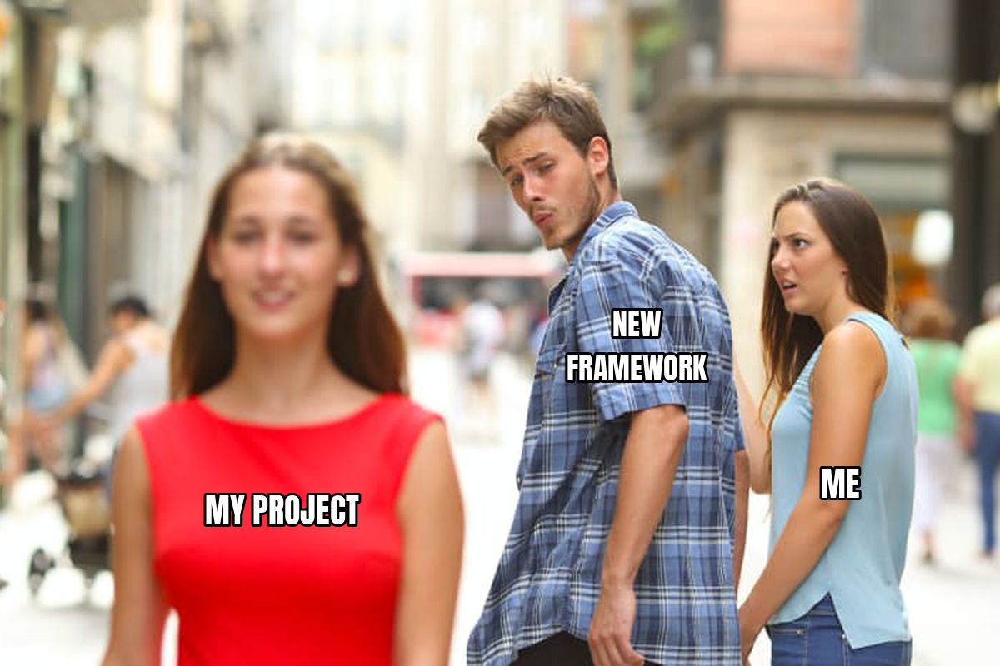
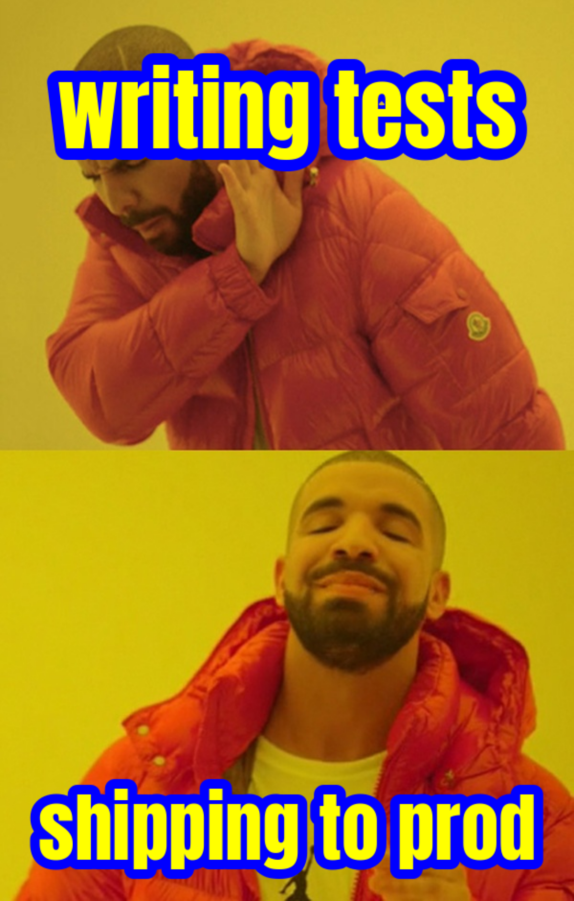
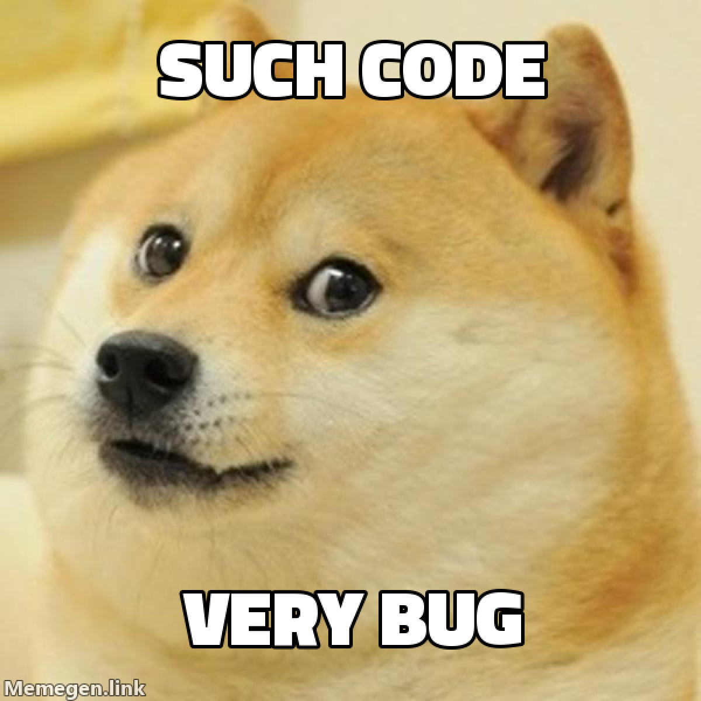
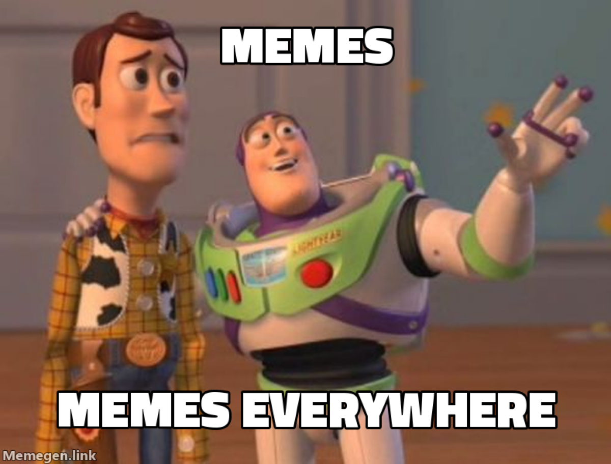
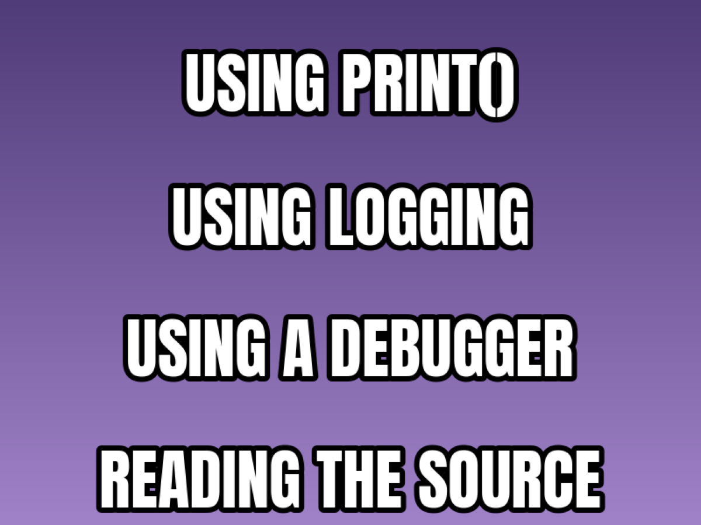
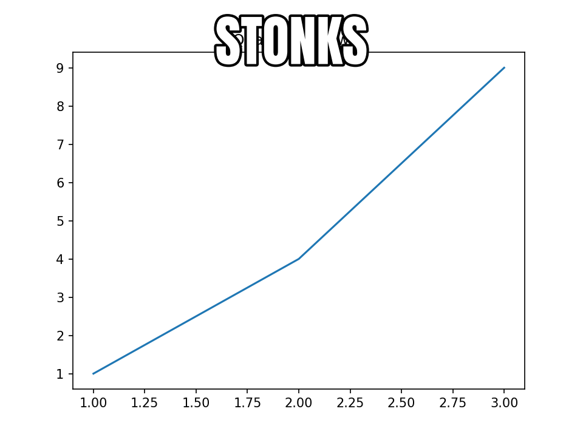
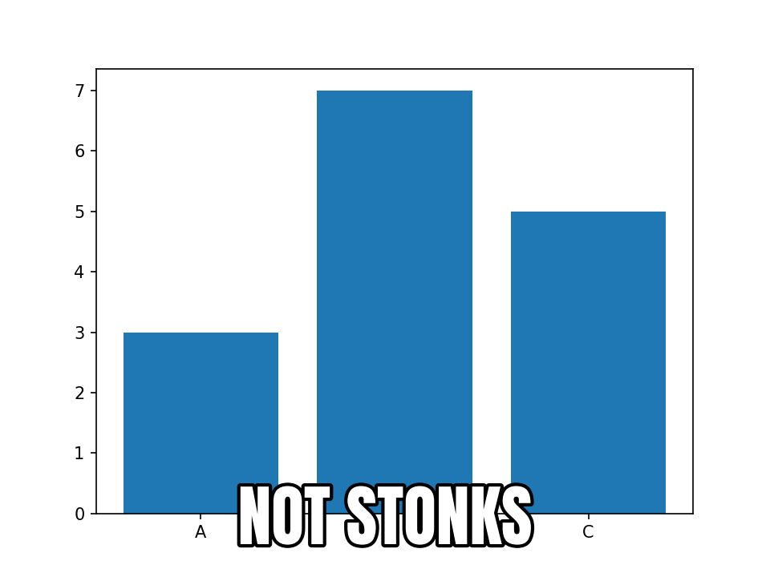
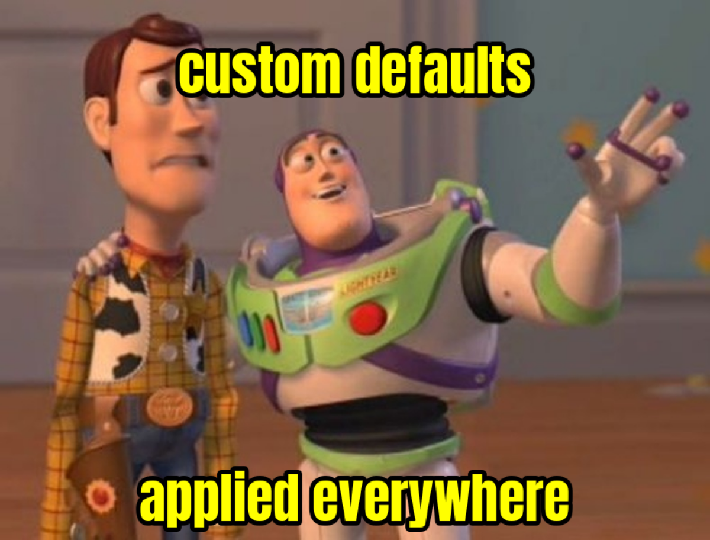
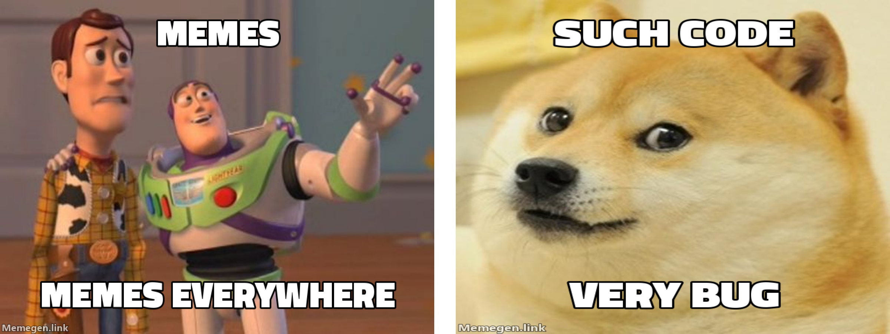

User Guide
==========

This guide covers the full breadth of memeplotlib's functionality.

.. contents:: On this page
   :local:
   :depth: 2

Functional API
--------------

The :func:`~memeplotlib.meme` function is the quickest way to create a meme.
It returns a ``(Figure, Axes)`` tuple so you can continue to modify the plot:

.. code-block:: python

   import memeplotlib as memes

   fig, ax = memes.meme("distracted", "my project", "new framework", "me",
                         show=False)
   fig.savefig("distracted.png", dpi=200)

All text styling parameters are available as keyword arguments:

.. code-block:: python

   memes.meme("drake", "writing tests", "shipping to prod",
              font="impact", color="yellow", outline_color="blue",
              outline_width=3.0, style="none", show=False)

Object-Oriented API
--------------------

The :class:`~memeplotlib.Meme` class provides a fluent, chainable interface:

.. code-block:: python

   from memeplotlib import Meme

   Meme("doge").top("such code").bottom("very bug").show()

You can also build a meme step-by-step:

.. code-block:: python

   m = Meme("buzz")
   m.top("memes")
   m.bottom("memes everywhere")
   fig, ax = m.render()
   m.save("output.png")

The :meth:`~memeplotlib.Meme.text` method sets text at an arbitrary index,
which is useful for templates with more than two text positions:

.. code-block:: python

   m = Meme("expanding-brain")
   m.text(0, "using print()")
   m.text(1, "using logging")
   m.text(2, "using a debugger")
   m.text(3, "reading the source")
   m.show()

You can also pass initial text lines directly to the constructor:

.. code-block:: python

   m = Meme("buzz", "memes", "memes everywhere")
   m.show()

.. image:: _static/examples/ug_oo_buzz_constructor.png
   :alt: Buzz Lightyear meme: "memes" / "memes everywhere"
   :width: 400px

Memifying Existing Figures
---------------------------

The :func:`~memeplotlib.memify` function overlays meme-style text on any
existing matplotlib figure:

.. code-block:: python

   import matplotlib.pyplot as plt
   import memeplotlib as memes

   fig, ax = plt.subplots()
   ax.plot([1, 2, 3], [1, 4, 9])
   ax.set_title("Quadratic growth")
   memes.memify(fig, "stonks")

The ``position`` parameter controls text layout:

- ``"top-bottom"`` (default) -- text at the top and bottom.
- ``"top"`` -- text at the top only.
- ``"bottom"`` -- text at the bottom only.
- ``"center"`` -- text centered vertically.

.. code-block:: python

   fig, ax = plt.subplots()
   ax.bar(["A", "B", "C"], [3, 7, 5])
   memes.memify(fig, "not stonks", position="bottom")

Accessibility: Alt Text
------------------------

A meme is text inside a picture, so screen-reader users need a text
alternative. Every render records one, generated from the template name
and the captions *as you typed them* (many screen readers spell out
ALL-CAPS words letter by letter, so the upper-cased image text is not
reused):

.. code-block:: python

   fig, ax = memes.meme("buzz", "memes", "memes everywhere")
   memes.get_alt_text(fig)
   # 'Meme using the "Buzz Lightyear" template. Top text: "memes".
   #  Bottom text: "memes everywhere".'

Pass ``alt_text=`` to :func:`~memeplotlib.meme`,
:func:`~memeplotlib.memify`, or :class:`~memeplotlib.Meme` (or call
:meth:`Meme.with_alt_text <memeplotlib.Meme.with_alt_text>`) to write your
own. When memeplotlib saves the file (``savefig=`` or ``Meme.save``), the
description is embedded as PNG/SVG ``Description`` or PDF ``Subject``
metadata. The CLI accepts ``--alt-text`` and prints the description after
saving, and the MCP ``meme`` tool returns it as ``alt_text``.

Global Configuration
---------------------

The :data:`~memeplotlib.config` mapping (a
:class:`~memeplotlib.MemeplotlibConfig`) holds defaults that apply
to every meme creation call unless overridden by keyword arguments. It
behaves like :data:`matplotlib.rcParams` — a validated key-value store:

.. code-block:: python

   import memeplotlib as memes

   memes.config["font"] = "comic"
   memes.config["color"] = "yellow"
   memes.config["outline_color"] = "blue"
   memes.config["outline_width"] = 3.0
   memes.config["style"] = "none"

For scoped overrides that auto-restore on block exit, use
:func:`~memeplotlib.rc_context`:

.. code-block:: python

   with memes.rc_context({"color": "yellow", "font": "comic"}):
       memes.meme("buzz", "scoped style")
   # config is back to its prior values here

All configuration keys (setting an unknown key raises ``KeyError``; a
wrongly typed value raises ``ValueError``):

.. list-table::
   :header-rows: 1
   :widths: 20 15 65

   * - Key
     - Default
     - Description
   * - ``font``
     - ``"impact"``
     - Font family name.
   * - ``color``
     - ``"white"``
     - Text fill color.
   * - ``outline_color``
     - ``"black"``
     - Text outline/stroke color.
   * - ``outline_width``
     - ``2.0``
     - Outline stroke width.
   * - ``fontsize``
     - ``72.0``
     - Base font size in points for auto-sizing. Explicit ``fontsize``
       keyword arguments override this.
   * - ``dpi``
     - ``150``
     - Dots per inch for figure rendering.
   * - ``style``
     - ``"upper"``
     - Text transform -- ``"upper"``, ``"lower"``, or ``"none"``.
   * - ``cache_enabled``
     - ``True``
     - Whether disk caching is enabled.
   * - ``cache_dir``
     - ``None``
     - Custom cache directory (platform default if ``None``).
   * - ``api_base``
     - ``"https://api.memegen.link"``
     - Base URL for the memegen API.
   * - ``api_timeout``
     - ``10``
     - Seconds to wait for memegen metadata requests.
   * - ``image_timeout``
     - ``15``
     - Seconds to wait for image downloads.
   * - ``max_retries``
     - ``2``
     - Retries for failed HTTP requests (429 and 5xx responses).
   * - ``retry_backoff``
     - ``0.5``
     - Exponential backoff factor between retries, in seconds.
   * - ``backend``
     - ``"auto"``
     - Default rendering backend: ``"auto"``, ``"memegen"``,
       ``"pillow"``, or ``"matplotlib"``. See `Rendering Backends`_.
   * - ``extension``
     - ``"png"``
     - Image format requested from memegen: ``"png"``, ``"jpg"``,
       ``"jpeg"``, ``"gif"``, or ``"webp"``.
   * - ``width``
     - ``None``
     - Output width in pixels for memegen renders.
   * - ``height``
     - ``None``
     - Output height in pixels for memegen renders.
   * - ``layout``
     - ``None``
     - memegen layout (e.g. ``"top"``).
   * - ``background``
     - ``None``
     - Custom background image URL forwarded to memegen.

Rendering Backends
-------------------

:func:`~memeplotlib.meme` and :class:`~memeplotlib.Meme` can draw captions
three ways. You rarely need to choose; the default ``backend="auto"``
picks for you:

``"memegen"``
    The memegen service renders the finished image server-side, matching
    memegen.link exactly. Used for memegen template IDs when you only set
    options memegen understands (font, color, style, size, layout).
``"pillow"``
    The blank template is downloaded and captions are drawn locally with
    Pillow. Used for your own images and URLs, and whenever you ask for
    something memegen can't do: an explicit ``fontsize``, a custom
    ``outline_color`` / ``outline_width``, or per-line styling with
    :meth:`Meme.line <memeplotlib.Meme.line>`.
``"matplotlib"``
    Captions are drawn as matplotlib text artists. Use it when you need
    extra :meth:`~matplotlib.axes.Axes.text` keyword arguments such as
    ``rotation`` or ``alpha``.

Pass ``backend=...`` to force one, or set ``config["backend"]`` to change
the default. Because the backends rasterize text differently, the same
caption can look slightly different across them; ``fontsize`` in
particular is in points for matplotlib but in pixels of the template image
for Pillow.

The Pillow and matplotlib backends place captions in each template's text
boxes. memegen's API doesn't publish those boxes, so memeplotlib ships a
snapshot of them from the memegen repository for templates whose boxes
aren't plain top/bottom (``gru``, ``db``, ``woman-cat``, and others). Any
other template gets top/bottom boxes, or equal horizontal bands when it
has three or more lines.

Template Discovery
-------------------

The :class:`~memeplotlib.TemplateRegistry` class lets you search and browse
the available meme templates:

.. code-block:: python

   from memeplotlib import TemplateRegistry

   reg = TemplateRegistry()

   # Search by keyword
   results = reg.search("dog")
   for r in results:
       print(r["id"], r["name"])

   # List all templates
   all_templates = reg.list_all()

   # Fetch a specific template
   template = reg.get("doge")

   # Force refresh from the API
   reg.refresh()

Templates are represented by the :class:`~memeplotlib.Template` dataclass.
You can create templates from local images or URLs using class methods:

.. code-block:: python

   from memeplotlib import Template

   # From a local image
   t = Template.from_image("my_photo.jpg", lines=3, name="Custom")

   # From a URL
   t = Template.from_image("https://example.com/image.png")

   # From the memegen API
   t = Template.from_memegen("buzz")

Caching
--------

memeplotlib caches downloaded template images and the template catalog to
disk so that subsequent runs do not require network access. The cache uses
a two-level strategy:

1. **In-memory LRU** -- up to 50 images kept in RAM for the current session.
2. **On-disk file cache** -- images stored as PNG files, catalog as JSON
   with a 24-hour TTL.

The cache directory is ``config["cache_dir"]`` when set, otherwise the
platform default from :mod:`platformdirs` (typically
``~/.cache/memeplotlib`` on Linux, ``~/Library/Caches/memeplotlib`` on macOS).
Changing ``config["cache_dir"]`` takes effect immediately:

.. code-block:: python

   memes.config["cache_dir"] = "/tmp/meme-cache"

To clear the cache:

.. code-block:: python

   from memeplotlib._cache import TemplateCache
   TemplateCache().clear()

To disable caching entirely:

.. code-block:: python

   import memeplotlib as memes
   memes.config["cache_enabled"] = False

memegen API Key
----------------

memegen adds a small "Memegen.link" watermark to rendered images. If you
have a memegen API key with image access, memeplotlib sends it in the
``X-API-KEY`` header and asks for the watermark to be removed:

.. code-block:: bash

   export MEMEPLOTLIB_API_KEY=...   # preferred: keeps the key out of code

or, per session:

.. code-block:: python

   memes.config["api_key"] = "..."

The key is only sent to ``config["api_base"]``, never to other image
hosts, never placed in URLs, and masked in ``repr(memes.config)``.

Rendering onto Existing Axes
-----------------------------

Both the functional and OO APIs support rendering onto an existing matplotlib
axes, which is useful for creating subplot layouts:

.. code-block:: python

   import matplotlib.pyplot as plt
   import memeplotlib as memes

   fig, (ax1, ax2) = plt.subplots(1, 2, figsize=(16, 6))

   memes.meme("buzz", "memes", "memes everywhere", ax=ax1, show=False)
   memes.meme("doge", "such code", "very bug", ax=ax2, show=False)

   plt.tight_layout()
   plt.show()

